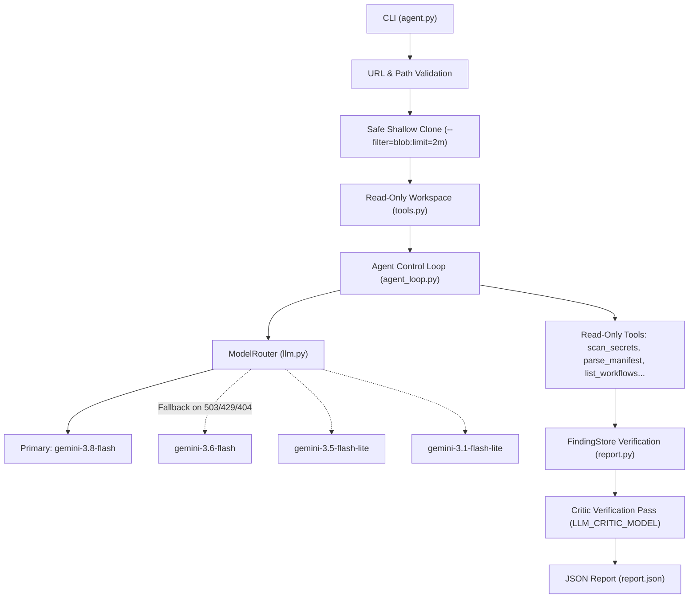

# DevOps Repository Auditing Agent

A plain-Python agent that inspects public GitHub repositories for defensible DevOps, CI/CD, and security defects, producing an evidence-backed JSON report.

The agent uses an explicit, deterministic plain-Python control loop without external agent frameworks (no LangChain, LangGraph, CrewAI, AutoGen, or LlamaIndex). The LLM autonomously and dynamically decides which read-only inspection tools to invoke based on earlier findings and repository structure.

---

## Output Contract & JSON Schema

The agent outputs a strictly formatted JSON report conforming to [`schemas/report.schema.json`](schemas/report.schema.json).

### Format

```json
{
  "repository": "https://github.com/octocat/Hello-World",
  "violations": [
    {
      "rule_id": "HYG-001",
      "category": "repository_hygiene",
      "severity": "low",
      "file": null,
      "line": null,
      "description": "Repository does not define a standard OSS license file (LICENSE or LICENSE.md).",
      "evidence": "No LICENSE, LICENSE.md, or COPYING file found in the repository root directory.",
      "recommendation": "Add an open-source license such as MIT, Apache-2.0, or BSD to clarify usage terms."
    }
  ]
}
```

- **Severity levels**: `critical`, `high`, `medium`, `low`.
- **Nullable fields**: `file` and `line` are null for repository-wide absence findings.
- **Redaction guarantee**: Secret values are masked with `[REDACTED*]` tokens across all findings, evidence, logs, and traces.

---

## Quickstart

### Prerequisites
- Python 3.10+
- Git installed on `PATH`
- A Gemini API key from [Google AI Studio](https://aistudio.google.com/)

### Setup

```bash
python -m venv .venv
source .venv/bin/activate                 # Windows: .venv\Scripts\Activate.ps1
pip install -r requirements.txt
cp .env.example .env                      # Configure GEMINI_API_KEY
```

### Running an Audit

```bash
python agent.py \
  --repo https://github.com/OWNER/REPOSITORY \
  --output report.json \
  --trace-output trace.jsonl \
  --max-steps 40 \
  --timeout-seconds 600
```

### CLI Options

| Flag | Required | Default | Description |
|---|:---:|:---:|---|
| `--repo` | Yes | - | Public GitHub HTTPS URL |
| `--output` | Yes | - | Destination path for JSON report |
| `--trace-output` | No | None | Optional JSONL path for redacted tool-call trace |
| `--max-steps` | No | 40 | Maximum turns before audit forces completion |
| `--timeout-seconds`| No | 600 | Global audit deadline in seconds (max 600) |
| `--no-critic` | No | False | Skip the LLM critic verification pass |
| `--debug` | No | False | Output full traceback on fatal errors (secrets remain redacted) |

---

## Architecture



### Core Architecture Principles
1. **Plain Python Execution Loop**: Zero dependencies on heavyweight orchestration libraries. The loop directly coordinates prompt generation, function-calling serialization, error backoff, tool execution, and finding validation.
2. **Dynamic Tool Calling**: No hardcoded checklist or pre-run scripts. The model explores the repository dynamically based on findings (e.g. investigating manifests after seeing `package.json` or running `git_show` after seeing suspicious commits).
3. **Resilient Model Health Tracking (`ModelRouter`)**: Tracks availability, 429 rate-limit cooldowns, and 404 model retirement. Models recovering from rate limits automatically return to primary priority without permanent downgrade.
4. **Critic Verification Pass**: Every candidate finding is independently reviewed by `LLM_CRITIC_MODEL` against extracted surrounding context to eliminate false positives and catch compensating controls.
5. **Defense-in-Depth Safety**:
   - Shallow clone with `--filter=blob:limit=2m`, `--no-recurse-submodules`, and `MAX_REPO_MB` size guards.
   - Isolated worker process with timeout for ReDoS defense in `search_code`.
   - Comprehensive secret pattern redaction (JWT, Stripe, SendGrid, Twilio, GCP/Azure service accounts, DB connection strings).
   - Prompt injection defense: repository contents are strictly formatted as tool data messages.

---

## Configuration Reference

All settings can be configured via environment variables or `.env`:

| Variable | Default | Description |
|---|---|---|
| `GEMINI_API_KEY` | - | Google Gemini API Key |
| `LLM_PROVIDER` | `gemini` | `gemini` or `openai_compatible` |
| `LLM_MODEL` | `gemini-3.8-flash` | Primary model ID |
| `LLM_FALLBACK_MODELS` | `gemini-3.6-flash,gemini-3.5-flash-lite,gemini-3.1-flash-lite` | Priority-ordered fallback models |
| `LLM_CRITIC_MODEL` | `gemini-3.1-flash-lite` | Secondary verification critic model |
| `LLM_THINKING_LEVEL` | `medium` | `low`, `medium`, `high`, or `minimal` |
| `ENABLE_CRITIC` | `true` | Enable/disable critic verification pass |
| `MAX_STEPS` | `40` | Maximum audit steps |
| `MAX_REPO_MB` | `500` | Maximum allowable repo working tree size |
| `LLM_TIMEOUT_MS` | `60000` | Per-call request timeout in milliseconds |
| `LLM_MAX_RETRIES` | `4` | Transient error retry attempts per model |
| `CLONE_TIMEOUT_SECONDS` | `120` | Maximum git clone duration |
| `TOOL_TIMEOUT_SECONDS` | `30` | Default timeout for tool calls |

---

## Decision Logic & Safety Philosophy

- **Snippet Verification**: Findings in files require verbatim snippet verification. The agent strips line-number prefixes automatically and confirms the snippet exists in the file before acceptance.
- **Read-Only Enclosure**: Repository code is never executed, installed, or compiled. All inspection is static or via read-only git operations.
- **Severity Rubric**:
  - `critical`: Exploitable remote code execution, unauthenticated write permissions on main, or live secret credentials with broad scopes.
  - `high`: Hardcoded passwords/API keys, missing build test gates on deployment pipelines, wildcard permissions.
  - `medium`: Insecure CI flags (`continue-on-error: true`), unpinned production dependencies, missing branch protection.
  - `low`: Repository hygiene, missing documentation, absence of optional files without evidence of direct outage or exploit.
- **Deduplication**: Overlapping findings within ±3 lines in the same file or findings with >= 0.7 description similarity in the same category are automatically deduplicated.

---

## Sample Trace Excerpt

```json
{"step": 1, "tool": "list_files", "arguments": {}, "output": "app.py (140 bytes)\nREADME.md (500 bytes)"}
{"step": 2, "tool": "read_file", "arguments": {"path": "app.py"}, "output": "1: import os\n2: DB_PASSWORD = \"[REDACTED]\"\n3: def connect(): ..."}
{"step": 3, "tool": "report_violation", "arguments": {"rule_id": "SEC-001", "category": "security", "severity": "high", "file": "app.py", "line": 2, "description": "Hardcoded database password in application source.", "evidence": "DB_PASSWORD = \"[REDACTED]\"", "recommendation": "Load database credentials from secure environment variables or vault.", "snippet": "DB_PASSWORD = \"[REDACTED]\""}, "output": "Finding recorded."}
```
